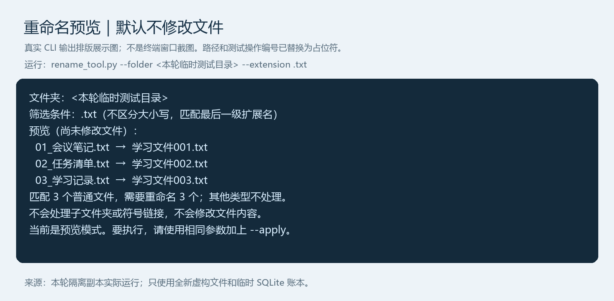
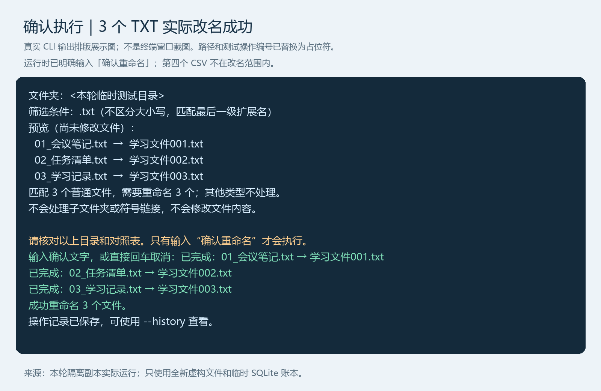
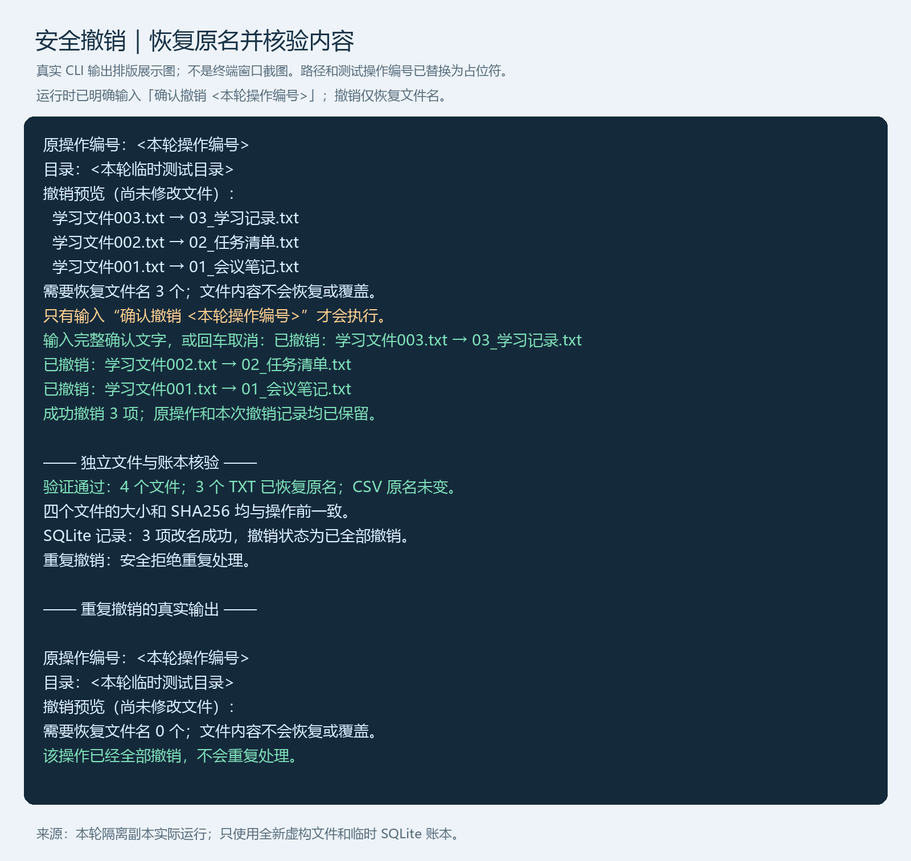

# Python 批量文件重命名工具

> 面向 Windows 本地文件夹的 Python 学习工具：先预览、明确确认，再执行；保存操作历史，并按记录安全检查后撤销文件名变更。
>
> **English:** A Windows Python learning tool for preview-first batch file renaming, explicit confirmation, SHA256 checks, persistent operation history and guarded undo.

本项目使用 **Codex 辅助编程**，通过分阶段开发、隔离测试和真实临时文件演练学习文件操作安全。它是实习求职作品与学习项目，没有真实企业部署或商业使用业绩的声明。请先使用新建临时文件练习。

## 功能概览

| 功能 | 当前支持 |
| --- | --- |
| 中文图形界面 | 鼠标选择文件夹、扩展名筛选、旧名/新名预览、确认执行及逐项结果 |
| 批量命名 | 默认学习文件001、学习文件002……，保留原文件的全部后缀；命令行支持前缀及起始编号 |
| 文件筛选 | 一次指定一种最后一级扩展名，如 .txt；大小写不敏感 |
| 预览与确认 | 默认仅预览；实际改名必须输入完整“确认重命名” |
| 内容校验 | 预览记录 SHA256，执行前重新比较；大小、修改时间相同但内容变化也拒绝旧计划 |
| 操作记录 | SQLite 保存目录、时间、操作编号、原名、新名、SHA256 及逐项状态 |
| 历史与撤销 | 命令行查看历史、按操作编号预览撤销；再次明确确认后才执行 |
| 操作后复核 | 正向与撤销均复核文件身份、类型、大小、修改时间、SHA256 及必要目录状态 |

图形界面复用命令行的计划与执行函数，没有另一套绕过检查的改名逻辑。**历史查看和撤销目前只在命令行提供。**

## 环境与启动

已验证 Python **3.13.2**，主要运行场景为 **Windows 11 本地普通文件夹**。改名和撤销执行阶段仅支持 Windows。

本工具仅使用 Python 标准库（包括 tkinter、sqlite3），不需要第三方 pip 依赖。Python 安装需包含 Tcl/Tk 才能运行图形界面及 GUI 测试；程序不会自动安装组件。

在 VS Code 打开本项目文件夹，在该目录的终端运行：

~~~powershell
python --version
python -B -X utf8 rename_gui.py
~~~

先确认 python 指向已配置的 Python 3.13 环境。-B 避免生成 Python 缓存，-X utf8 帮助终端显示中文。也可以使用自己已有虚拟环境的 Python 完整路径启动。

### 图形界面使用

1. 选择自己新建的临时测试文件夹，不能选择程序自身目录。
2. 筛选框填写 .txt，或留空处理该目录内所有普通文件；不递归处理子目录。
3. 点击“生成预览”，核对旧文件名、新文件名和数量。此时不改名、不写入账本。
4. 点击“确认并执行”，再次核对目录，输入完整的“确认重命名”。取消或输入其他文字都不会执行。
5. 查看成功、失败、待核查及未执行结果。失败或待核查时停止后续文件，不会自动重试或回滚。

更换目录或筛选条件会使预览失效。当前界面使用默认命名规则，不提供逐个编辑新名字、前缀/起始编号设置、历史或撤销窗口。

## 命令行演示：只使用全新临时文件

以下 PowerShell 命令新建独立临时目录，放入两个模拟 TXT 和一个 CSV，不接触现有个人文件：

~~~powershell
$demo = Join-Path ([IO.Path]::GetTempPath()) ("rename-demo-" + [guid]::NewGuid().ToString("N"))
New-Item -ItemType Directory -Path $demo | Out-Null
Set-Content -LiteralPath (Join-Path $demo "01_笔记.txt") -Value "虚构练习内容一" -Encoding utf8
Set-Content -LiteralPath (Join-Path $demo "02_清单.txt") -Value "虚构练习内容二" -Encoding utf8
Set-Content -LiteralPath (Join-Path $demo "03_统计.csv") -Value "项目,数量" -Encoding utf8

# 只预览 TXT，CSV 不进入计划
python -B -X utf8 rename_tool.py --folder "$demo" --extension .txt
~~~

预期预览为：

~~~text
01_笔记.txt → 学习文件001.txt
02_清单.txt → 学习文件002.txt
~~~

确认目录及内容无误后，**自行选择是否执行**：

~~~powershell
python -B -X utf8 rename_tool.py --folder "$demo" --extension .txt --apply
~~~

--apply 会在这次运行中重新生成并显示预览，不会跳过确认；只有输入“确认重命名”才改名。三条文件内容均不应改变，CSV 保留原名。不要把示例路径替换成个人资料目录后直接执行。

### 常用参数

~~~powershell
# 自定义前缀与起始编号，只预览；示例会从“练习010”开始
python -B -X utf8 rename_tool.py --folder "$demo" --extension .txt --prefix "练习" --start 10

# 查看完整命令帮助
python -B -X utf8 rename_tool.py --help
~~~

- --folder：明确指定文件夹。默认指向项目内“测试文件”，但该练习数据目录没有上传，新下载者应自行准备或显式指定目录。
- --extension：匹配最后一级扩展名，txt、.txt、.TXT 等效。不加时处理所有普通文件；不支持通配符、同时多类型或 .tar.gz 复合筛选。
- --prefix / --start：命令行设置前缀和大于等于 1 的起始编号。编号至少三位，当前没有自定义位数选项。
- 保留全部后缀，例如报告.v1.txt 的新名仍带 .v1.txt；筛选时则只按最后的 .txt 匹配。
- 文件按原名的大小写折叠排序，再按原名排序；编号只分配给选中的文件。
- 生成名与既有文件或文件夹冲突时拒绝，不支持交换文件名或覆盖占用目标。

## 操作历史与撤销

查看操作编号和逐项状态：

~~~powershell
python -B -X utf8 rename_tool.py --history
~~~

将下面占位文字替换为历史中**完整的 32 位操作编号**，先预览：

~~~powershell
python -B -X utf8 rename_tool.py --undo "完整操作编号"
~~~

只有预览通过、目标确实是自己要恢复的文件，才选择执行：

~~~powershell
python -B -X utf8 rename_tool.py --undo "完整操作编号" --apply
~~~

此时必须输入“确认撤销 操作编号”，编号须与本次记录完全一致。撤销范围来自指定记录，不猜测“最新一笔”；不能与 --folder、--prefix、--start 或 --extension 混用。

撤销前检查文件身份、内容 SHA256、大小和修改时间，以及原名是否被占用。文件被删除、替换、修改、存在多个硬链接或原名被其他文件占用时拒绝；全部已撤销的记录不会重复执行。成功撤销只恢复文件名，**不会恢复已改动或删除的文件内容**。

账本默认保存在项目 .rename_history/operations.sqlite3，由首次实际执行时创建；纯预览、取消和空历史查询不创建操作账本。它记录绝对操作目录和文件名，可能包含本机信息，因此账本及辅助文件已被 .gitignore 排除，不能作为求职展示数据上传。

### 成功、失败与待核查有什么区别

程序按“持久保存计划 → 保存逐项执行意图 → 改名 → 操作后复核 → 提交成功记录”执行，正向和撤销都逐项记账，历史不会因撤销而删除。

| 状态 | 含义及处理 |
| --- | --- |
| 成功 | 操作后复核通过且成功结果已写入数据库 |
| 失败 | 能够确定该项没有完成并已记录原因；后续停止 |
| 未执行 / 无需修改 | 未轮到该项，或原名与目标名相同 |
| 待核查 | 中断、复核异常或记录失败使结果不明，文件可能已改名；不要直接重试 |

系统改名和 SQLite 提交不是同一事务。若改名成功但记录失败，保留先前的执行意图，不猜测成功或失败；有待核查记录的目录会被阻止继续改名或撤销。当前没有自动核查、解除阻止或修复工具，需先保留文件与账本并人工检查。

## 安全机制及边界

- 正向改名与撤销均检查目标占用，按 Windows 大小写不敏感规则处理冲突；不提供覆盖选项。
- 保护程序自身目录、账本、版本备份及相关别名；不处理目录中的符号链接，拒绝路径中的符号链接/目录联接和多个硬链接候选。
- 预览与执行绑定 SHA256 和文件状态，操作后再复核；发现异常立即停止。SHA256 每次按 1 MB 分块读取，但仍需读完文件。
- SQLite 写入锁约束使用同一账本的本工具实例；操作历史不等于文件备份，也不具备防恶意篡改认证。
- **并发风险尚未消除。**其他软件仍可能在检查与改名之间、复核期间或之后修改文件；当前没有 Windows 文件句柄绑定保护。请关闭正在编辑目标文件的程序，不要在同步或共享目录中首次试用。
- 部分成功时不会自动回滚、删除、覆盖或重试；撤销只处理已明确记录成功且仍满足检查的项目。
- 大文件反复计算 SHA256 会增加耗时；GUI 为单线程，可能暂时无响应，未提供后台任务或中途取消。强制退出可能留下待核查记录。
- 网络盘、同步盘、超大批量、真实断电和磁盘损坏未全面验证。请保留独立备份，只在可承受风险的临时副本上练习。

## 自动化测试

在具备可创建 Tk 窗口的 Windows 桌面环境运行：

~~~powershell
python -B -X utf8 -m unittest discover -q
~~~

本次展示文档核对时，使用现有 Python 3.13.2 在**系统临时目录中的逐文件哈希一致副本**运行，结果为：

~~~text
Ran 166 tests
OK
~~~

其中核心测试 145 项、GUI 测试 21 项。覆盖预览与取消、筛选、SHA256（含同大小同修改时间的内容变化）、硬链接、源码目录保护、目标冲突、SQLite 写入失败、部分成功、进程中断、撤销及重复撤销、操作后复核和 GUI 流程。

测试包含新建临时文件的实际改名/撤销以及故障注入；账本被定向至各用例的隔离目录，不使用正式操作记录。部分临时目录创建在测试源码旁并自动清理；若不希望原项目出现任何测试写入，可在临时副本运行。没有可用 Tk 桌面的环境不能据此声称完整 GUI 测试通过。

测试通过仅说明已覆盖情形符合预期，不代表不会丢失数据或适用于所有 Windows 文件系统及并发场景。

## 代码与展示材料

~~~text
rename_gui.py              第一版中文 Tkinter 界面
rename_tool.py             计划、确认、执行、内容校验及命令行入口
operation_history.py       SQLite 记录、目录保护及状态管理
undo_tool.py               按操作编号预览和执行撤销
test_*.py                  核心、账本、撤销、复核及 GUI 测试
学习指南.md                分阶段学习过程与更详细解释
~~~

详见[学习指南](学习指南.md)。指南保留历史开发阶段说明、原本机练习目录和备份信息；这些数据不随仓库分发，当前启动方式以本 README 为准。

### 真实运行展示

以下为**真实程序标准输出的排版展示图，不是终端窗口截图，也不是新增 GUI**。本轮使用逐文件校验一致的隔离源码副本、全新虚构文件和临时 SQLite 账本完成演示；仅将路径和测试操作编号替换为占位符。确认文字在本次演示中已明确提供，日常使用仍必须核对预览并确认。

**1. 只预览：**3 个 TXT 进入计划，第四个 CSV 不参与；此时文件和账本没有改变。

**2. 确认执行：**输入“确认重命名”后实际改名 3 项，SQLite 逐项记录成功，CSV 保持原名。

**3. 安全撤销与核验：**先预览，再输入包含完整操作编号的确认文字。3 个 TXT 恢复原名，4 个文件的数量、大小及 SHA256 与操作前完全一致；历史保留，重复撤销未再次处理文件。图中“独立文件与账本核验”是本轮额外验证摘要，其余操作段落来自程序实际输出。

图片仅展示本次临时样本验证结果，不代表已消除全部并发、断电或文件系统风险。可点击查看原尺寸；操作方法见上文，不要照用示例操作编号处理自己的历史记录。PNG 为静态展示材料，程序不会自动刷新图片。

## AI 辅助开发说明

使用 Codex 帮助拆解需求、实现功能、编写测试和审查修改；通过预览、明确确认、隔离测试和保留 Git 历史逐步验证。求职展示时应如实说明这是 AI 辅助完成的学习项目，并能够独立运行、解释关键保护与限制，不将生成代码等同于掌握全部实现。
